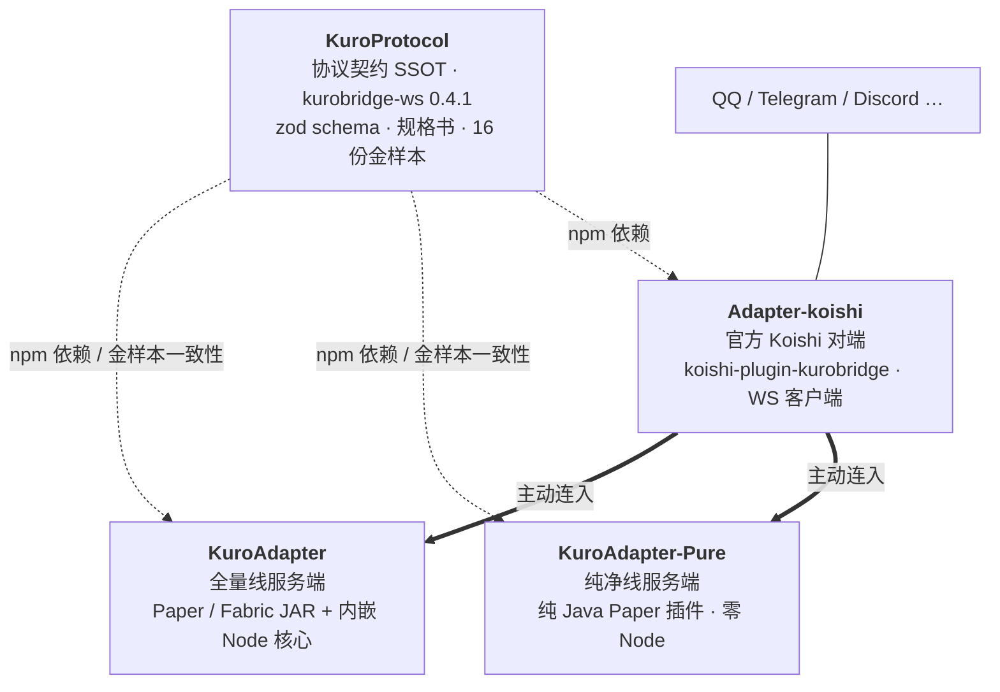

<!-- GitHub 组织主页读取本文件；仓库首页主文件为 ../README.md，两份内容保持同步。 -->
<div align="center">


**Minecraft 服务器 ↔ 社交平台群服互通**

<small>一套自研 WebSocket 协议 · 两条 MC 服务端实现线 · 一个官方 Koishi 对端</small>

<p>
  &emsp;
  &emsp;
  
</p>

<p>
  <a href="#我们在做什么">我们在做什么</a> ·
  <a href="#生态全景">生态全景</a> ·
  <a href="#项目">项目</a> ·
  <a href="#设计原则">设计原则</a> ·
  <a href="#快速开始">快速开始</a> ·
  <a href="#english">English</a>
</p>

</div>

---

## 我们在做什么

**KuroBridge**（组织名 Kuro-Bridge）是一套开源的「Minecraft 服务器 ↔ 聊天平台」双向互通方案：把 QQ、Telegram、Discord 等群聊接进服务器，也把游戏里的动静送回群里。

- **聊天双向**：群消息进游戏，游戏内发言回群；富文本降级、`§` 色码剥离与超长截断由对端按平台能力处理。
- **事件广播**：进服、退服、死亡按绑定频道推送，状态快照供查询。
- **群指令**：以 `/` 开头的群消息可作为服务器命令执行，管理员权限判定在 MC 侧完成。
- **框架无关**：MC 侧只认自研的 `kurobridge-ws` 协议；Koishi、napukettoqq 或自己写的对端都能接入。

> KuroBridge 是独立社区项目，与任何机器人框架官方均无隶属关系。

## 生态全景



一句话：**协议只有一份，实现可以有很多份。** 两侧都只实现协议，不互相绑定框架。

## 项目

四个仓库组成一条完整链路：协议只定义一次，服务端与对端各自实现。

| 仓库 | 角色 | 技术形态 | 版本 |
| :--- | :--- | :--- | :--- |
| **[KuroProtocol](https://github.com/Kuro-Bridge/KuroProtocol)** | 协议契约 SSOT | zod schema + 规格书 + 16 份金样本；npm `@kuro-bridge/protocol` | `0.4.1` |
| **[KuroAdapter](https://github.com/Kuro-Bridge/KuroAdapter)** | 全量线服务端 | Paper / Fabric JAR，Java 薄壳 + 内嵌 Node 业务核心 | `0.1.0` |
| **[KuroAdapter-Pure](https://github.com/Kuro-Bridge/KuroAdapter-Pure)** | 纯净线服务端 | 纯 Java Paper 插件，零 Node / 零子进程 / 零 IPC | `0.1.0` |
| **[Adapter-koishi](https://github.com/Kuro-Bridge/Adapter-koishi)** | 官方参考对端 | Koishi v4 插件 `koishi-plugin-kurobridge`（WS 客户端） | `0.2.0` |

> 协议 `0.4.1` 是发布工程补丁，帧、金样本与线协议行为同 `0.4.0`。

### 怎么选服务端

| 维度 | KuroAdapter · 全量线 | KuroAdapter-Pure · 纯净线 |
| :--- | :--- | :--- |
| 运行时 | Java 薄壳看护内嵌 Node 子进程 | 单 JVM，纯 Java |
| 协议对齐 | 直接消费 npm zod schema | 金样本逐帧一致性门禁 |
| 内嵌聊天端 | `embedded` 形态可内嵌 napuketto，扫码登录 QQ | 无，需外部对端连入 |
| 平台面 | Paper / Fabric 已可用；LSE / Endstone 已实现（待真机）；NeoForge / Velocity 仅骨架 | Paper（1.21.4 真机验证） |
| 适合 | 想开箱即用、需要多平台 | 不想在 MC 机器上跑 Node |

> `embedded` 形态随包附带的是 Windows x64 的 Node 与 napuketto；其他平台需自备 Node 运行时。

### 四个仓库，各管一段

- **KuroProtocol**：协议的家。帧名与字段只认 `src/` 的 zod schema，规格书与金样本是它的投影。子协议 `kurobridge-ws.v1`，主版本相同即兼容；入站 5 种帧、出站 10 种帧。
- **KuroAdapter**：产品名与仓名不同——仓库叫 `KuroAdapter`，产品叫 KuroBridge。它把 Node 运行时、业务核心与平台薄壳打进同一个 JAR，是平台覆盖最广的一条线。
- **KuroAdapter-Pure**：给「服务器上不想多一个进程」的服主。协议编解码、WS 服务端与业务骨架全部 Java 手写，首启自动生成安全配置（随机 token），`/kurobridge reload` 热更绑定与管理员。
- **Adapter-koishi**：Koishi v4 插件，也是官方参考实现。它是 WS 客户端，不监听端口，断线重连自负；绑定哪些群由 MC 侧决定。

## 设计原则

1. **协议只有一份。** 帧名与字段以 KuroProtocol 的 zod schema 为准，任何实现禁止手写消息类型；文档与 schema 冲突时改文档。
2. **服务端永远被动。** MC 侧只监听，对端主动连入；服务端不回连，重连策略由对端自担。
3. **一致性靠金样本。** 16 份 v0.4 金样本 + `SHA256SUMS` 是跨仓物理契约；全量线、纯净线、官方对端任一漂移，对应测试立即变红。
4. **变更四件套。** 改协议 = 一次提交同时改齐 schema、规格书、金样本、版本沿革，缺一即门禁红。
5. **实现可以多，语义只有一套。** 全量线与纯净线是同一协议行为的两种工程取舍，不是两个产品。

## 快速开始

**1. 在 MC 侧装服务端**（二选一）

```bash
# 纯净线：纯 Java，需要 JDK 25（推荐用 mise）
git clone https://github.com/Kuro-Bridge/KuroAdapter-Pure
cd KuroAdapter-Pure && mise run jar
# → paper/build/libs/kuroadapter-pure-0.1.0.jar

# 全量线：内嵌 Node，需要 Node 26 + pnpm
git clone https://github.com/Kuro-Bridge/KuroAdapter
cd KuroAdapter && pnpm install && pnpm build:jar
# → platforms/je/paper/build/libs/kurobridge-0.1.0.jar
```

把 JAR 放进 Paper 的 `plugins/` 目录。首次启动会生成配置：纯净线在 `plugins/KuroBridgePure/config.json`，全量线在 `plugins/kurobridge/config.json`；在 `ws` 段固定端口，并设置一个非空 `token`。

**2. 在 Koishi 侧装对端**

```bash
npm i koishi-plugin-kurobridge
```

启用插件，`url` 填 `ws://<服务器地址>:<端口>`，`token` 与 MC 侧一致，再把目标群加入 MC 侧的 `channels` 绑定表。

**3. 验证**

Koishi 日志出现握手成功与绑定快照后，群消息应进游戏，游戏内发言应回群。

> [!WARNING]
> 协议是明文 WebSocket。跨公网部署请走隧道或反向代理做 TLS 终结（`wss://`），不要把端口直接暴露在公网。

## 工程基线

| 仓库 | 技术栈 | 提交前门禁 |
| :--- | :--- | :--- |
| KuroProtocol | TypeScript 7 · zod · pnpm | `pnpm gate` |
| KuroAdapter | TypeScript 7 · Java 25（target 21）· Gradle · pnpm | `pnpm check && pnpm test` |
| KuroAdapter-Pure | Java 25（release 21）· Gradle · mise | `mise run build` |
| Adapter-koishi | TypeScript 7 · Koishi v4 · tsdown · Bun | `bun run check && bun run test` |

- 每个仓库的 `AGENTS.md` 是硬约束与工作流的入口；架构决策与设计记录在各自的 `docs/`。
- 全部项目以 **MIT** 许可开源，文档与提交信息以简体中文为主。

## 参与与反馈

欢迎在对应仓库提 Issue 或 PR。开始之前，建议先读该仓的 `AGENTS.md` 与 `docs/`，门禁与红线都写在里面。

- 协议怎么接：[KuroProtocol 文档](https://github.com/Kuro-Bridge/KuroProtocol/blob/main/docs/README.md)
- 服务器怎么部署：[KuroAdapter](https://github.com/Kuro-Bridge/KuroAdapter#readme) · [KuroAdapter-Pure](https://github.com/Kuro-Bridge/KuroAdapter-Pure#readme)
- 对端怎么装：[Adapter-koishi](https://github.com/Kuro-Bridge/Adapter-koishi#readme)

## English

KuroBridge is an open-source bridge between Minecraft servers and chat platforms. The wire protocol — `kurobridge-ws` (subprotocol `kurobridge-ws.v1`) — is defined once in **KuroProtocol**: zod schemas as the single source of truth, a cross-repo specification, and 16 golden fixtures, published as `@kuro-bridge/protocol`. Two server implementations consume it: **KuroAdapter** (Paper / Fabric JAR with an embedded Node core) and **KuroAdapter-Pure** (pure Java, zero Node). **Adapter-koishi** (`koishi-plugin-kurobridge`) is the official Koishi v4 peer and connects as a WebSocket client. All projects are MIT-licensed.
